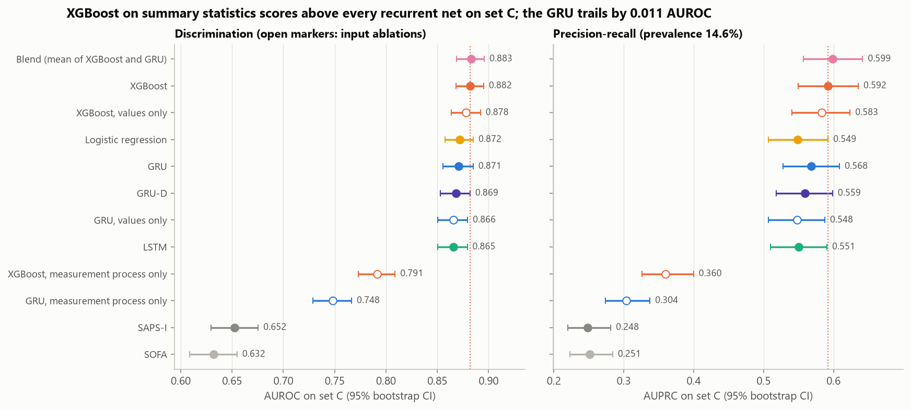
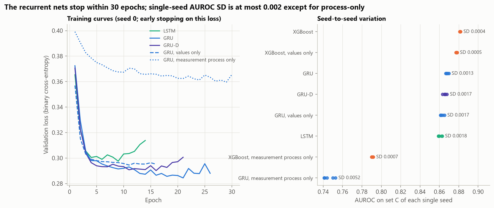
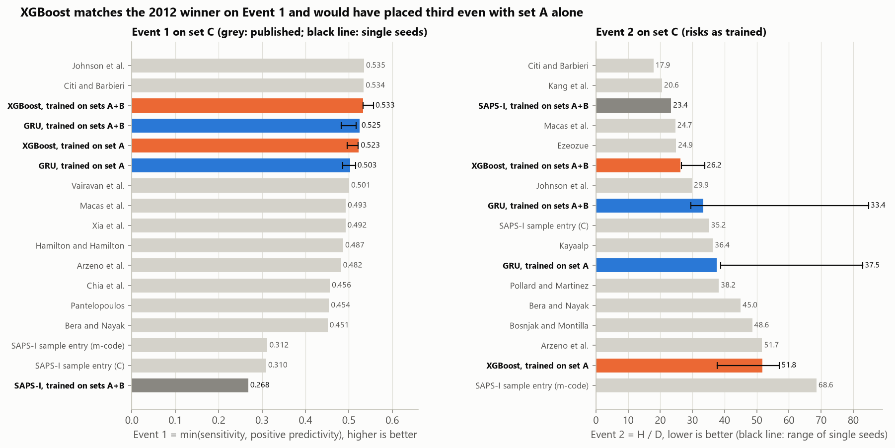
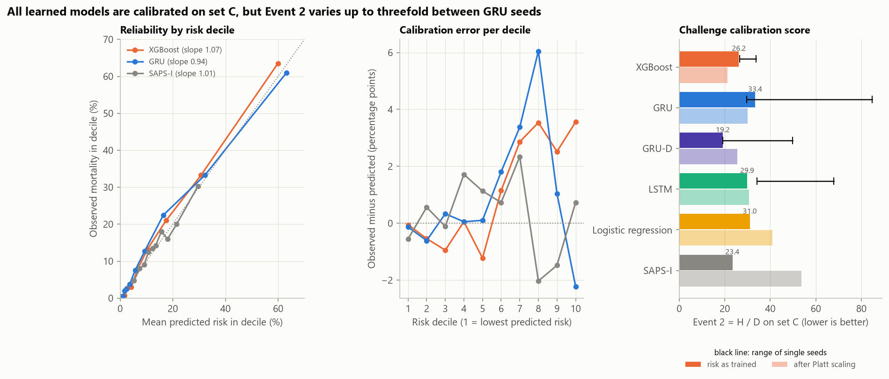
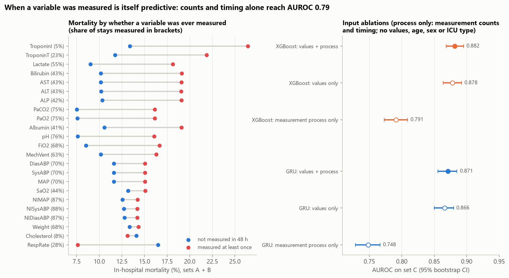
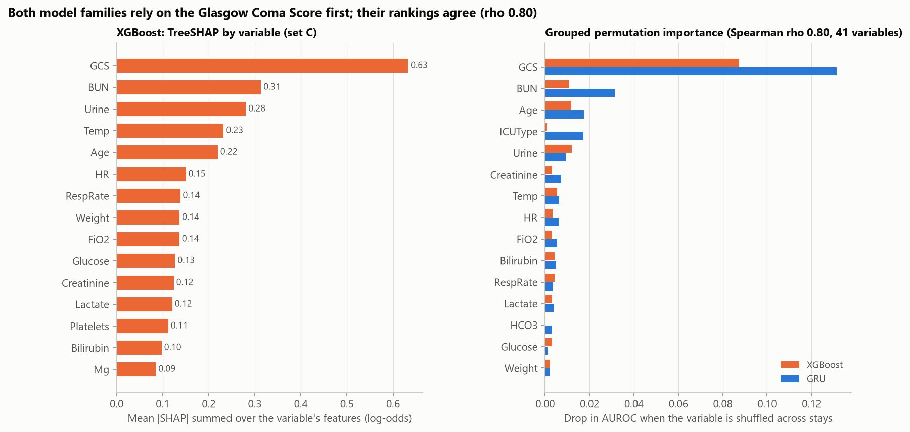
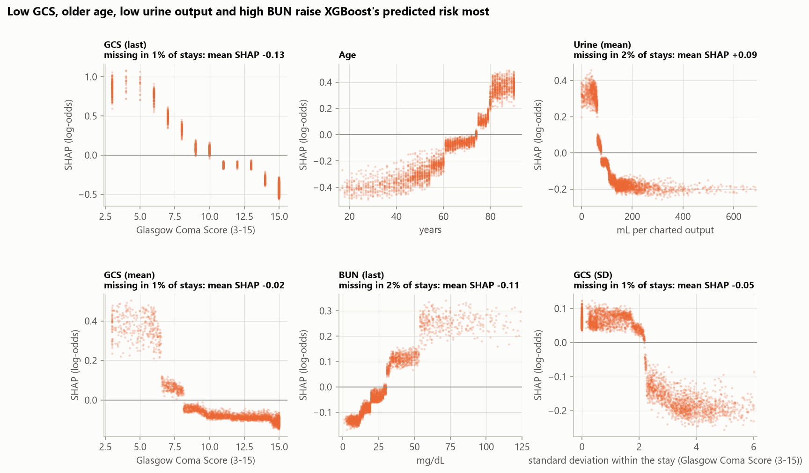
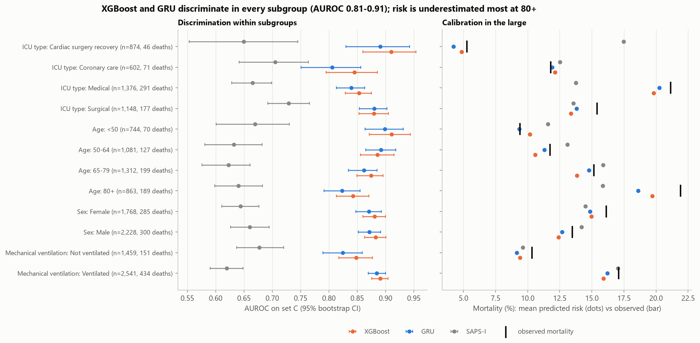
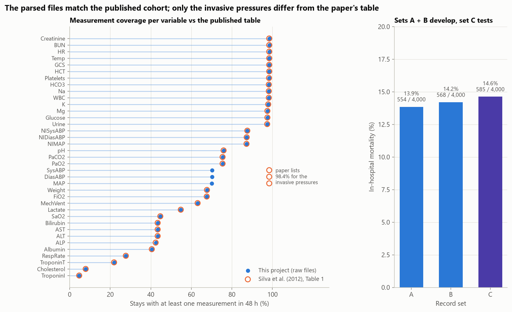

# ICU Mortality from Irregular Vital-Sign Time Series

**Do recurrent networks that read the raw, irregular first 48 hours of an ICU stay predict in-hospital death better
than a gradient-boosted tree on simple summary statistics, and how much of the signal lies in *when* things were
measured rather than in the values?** This project compares XGBoost and logistic regression on 341 summary features
with LSTM, GRU and GRU-D networks on hourly values, observation masks and time gaps, using the 12,000 ICU stays of the
PhysioNet/Computing in Cardiology Challenge 2012 and the challenge's own split: models are developed on sets A and B
and tested once on set C, the hidden test set that decided the challenge.

It mirrors the clinical decision-support work of a healthcare analytics team: a risk model is judged on
discrimination, on whether its risks are calibrated, on how it behaves in patient subgroups and on what it relies on,
and it is checked against published reference scores before anything is claimed.

> **Research use only.** This is a methodological comparison on a public research data set (adult ICU stays from one
> US academic hospital system, via MIMIC II). The models are not validated for any clinical use, and nothing here is
> medical advice.



## Key findings

| Set C (4,000 stays, 14.6% died); developed on sets A + B | AUROC [95% CI] | AUPRC | Brier | Event 1 | Event 2 |
|---|---:|---:|---:|---:|---:|
| **XGBoost**, 341 summary features (5 seeds averaged) | **0.882** [0.868, 0.895] | **0.592** | **0.0857** | **0.533** | 26.2 |
| Logistic regression, same features | 0.872 [0.858, 0.885] | 0.549 | 0.0900 | 0.516 | 31.0 |
| GRU, hourly values + mask + time gaps (5 seeds) | 0.871 [0.856, 0.885] | 0.568 | 0.0887 | 0.525 | 33.4 |
| GRU-D (5 seeds) | 0.869 [0.853, 0.882] | 0.559 | 0.0896 | 0.525 | 19.2 |
| LSTM (5 seeds) | 0.865 [0.850, 0.879] | 0.551 | 0.0906 | 0.501 | 29.9 |
| SAPS-I score, recalibrated | 0.652 [0.630, 0.676] | 0.248 | 0.1195 | 0.268 | 23.4 |
| Best published challenge entry on set C (2012) | | | | 0.5353 | 17.88 |

<sub>Event 1 = min(sensitivity, positive predictivity) at a threshold chosen on validation (higher is better); Event 2 =
range-normalised Hosmer-Lemeshow statistic H / D (lower is better), both computed as in the organisers' `score.c`.
All 18 configurations are in [`model_results.csv`](reports/results/model_results.csv).</sub>

1. **Trees on summary statistics are not beaten by the sequence models.** XGBoost reaches AUROC 0.882 on set C. The
   GRU, the best recurrent model on validation, trails by 0.011 (95% CI [-0.018, -0.003]), which is not significant
   after Holm correction over 33 paired tests (p = 0.066); GRU-D (-0.013, p = 0.014) and the LSTM (-0.016,
   p < 0.001) are significantly behind. Averaging XGBoost and the GRU adds nothing (0.883). The SAPS-I and SOFA
   severity scores reach only 0.652 and 0.632.
2. **When a variable was measured is itself predictive.** With only the number and timing of measurements (no values,
   no age, sex or ICU type), XGBoost reaches AUROC 0.791 and a GRU 0.748. Mortality is 18.1% when lactate was measured
   in the first 48 hours and 9.0% when it was not. Giving the GRU the mask and time-gap inputs raises AUPRC by 0.020
   (Holm p = 0.005); GRU-D's learned decay adds nothing on top (-0.0025 AUROC vs the GRU, p = 0.66).
3. **XGBoost matches the 2012 winners on Event 1, but Event 2 is too noisy to rank models.** XGBoost scores 0.533
   [0.492, 0.573] on Event 1 (winner 0.5353, runner-up 0.5345), and 0.523 when developed on set A alone, the labelled
   data the participants had; both would have placed third. Its Event 2 of 26.2 would have placed fifth (21.2 after
   Platt scaling). But single seeds of the same model score 26.7-33.8 (XGBoost) and 29.6-84.8 (GRU), so differences
   smaller than about a factor of two are within seed noise.
4. **The risks are calibrated, but set C is slightly sicker.** Calibration slopes are 0.94-1.07 and the decile ECE
   1.1-1.8% for every model in the table above; the learned models predict a little too low (XGBoost 13.5% vs 14.6%
   observed), most for patients aged 80 and over (19.7% vs 21.9%).
5. **Both families read the same physiology.** The Glasgow Coma Score dominates: 0.63 log-odds of mean absolute TreeSHAP
   for XGBoost, and shuffling it costs XGBoost 0.087 AUROC and the GRU 0.131. Variable rankings by grouped permutation
   importance agree (Spearman 0.80 over 41 variables); BUN, urine output, age and temperature follow.
6. **The data check passes.** 18 of 20 statistics published by the organisers are reproduced (the two misses trace
   to inconsistencies in the sources: the published ICU-type shares sum to 106.4%, and 85 recorded deaths break
   the documented survival rule), the measurement coverage matches the paper's Table 1 for 33 of 37 variables, and the scorer
   reproduces the organisers' own set A scores of their SAPS-I sample entry (Event 1 0.2957 vs 0.296, Event 2 68.4 vs
   68).

## Results

### Model comparison

Paired differences on set C use the same 1,000 bootstrap resamples for every model and are Holm-corrected together
([`significance.csv`](reports/results/significance.csv)):

| Comparison | AUROC difference [95% CI] | Holm p | AUPRC difference | Holm p |
|---|---:|---:|---:|---:|
| GRU vs XGBoost | -0.011 [-0.018, -0.003] | 0.066 | -0.024 | 0.40 |
| GRU-D vs XGBoost | -0.013 [-0.021, -0.006] | **0.014** | -0.033 | 0.10 |
| LSTM vs XGBoost | -0.016 [-0.024, -0.009] | **< 0.001** | -0.041 | **0.011** |
| Logistic regression vs XGBoost | -0.010 [-0.017, -0.002] | 0.13 | -0.043 | **0.034** |
| Blend (mean of XGBoost and GRU) vs XGBoost | +0.001 [-0.003, +0.005] | 1.0 | +0.007 | 0.90 |
| GRU-D vs GRU | -0.0025 [-0.006, +0.001] | 0.66 | -0.010 | 0.48 |
| GRU vs LSTM | +0.006 [+0.002, +0.009] | **0.042** | +0.018 | **0.021** |
| GRU vs GRU without mask and time gaps | +0.005 [+0.001, +0.009] | 0.13 | +0.020 | **0.005** |
| XGBoost vs XGBoost without counts and timing | +0.004 [0.000, +0.007] | 0.40 | +0.009 | 0.61 |

<sub>Bold: Holm-adjusted p < 0.05 (33 tests: the nine comparisons above plus SAPS-I and SOFA vs XGBoost, each on AUROC,
AUPRC and Brier score).</sub>

Seeds matter little for ranking: the AUROC of single seeds has a standard deviation of 0.0004 for XGBoost and
0.0013-0.0018 for the recurrent nets ([`seed_results.csv`](reports/results/seed_results.csv)), and averaging five
seeds adds 0.003 AUROC for the GRU. Doubling the labelled data from set A to sets A and B raises AUROC by 0.017 for
XGBoost (0.865 to 0.882) and 0.014 for the GRU (0.857 to 0.871), so the gap between the families does not close with
more data in this range.



### Comparison with the 2012 challenge



The published final scores were computed by the organisers on set C, the same 4,000 stays used as the test set here
([`challenge_comparison.csv`](reports/results/challenge_comparison.csv)). Participants had outcomes for set A only and
could check up to ten entries against set B, so the fairer comparison is with models developed on set A alone
(3,200 fitting and 800 validation stays, hyperparameters re-tuned):

| On set C | Event 1 | Event 2 (as trained) | Event 2 (Platt-scaled on validation) |
|---|---:|---:|---:|
| Winners in 2012 (Johnson et al.; Citi and Barbieri) | 0.5353 | 17.88 | |
| XGBoost, developed on sets A + B | 0.533 (single seeds 0.533-0.557) | 26.2 (single seeds 26.7-33.8) | 21.2 |
| XGBoost, developed on set A | 0.523 (single seeds 0.496-0.521) | 51.8 (single seeds 37.7-57.1) | 22.0 |
| GRU, developed on sets A + B | 0.525 | 33.4 (single seeds 29.6-84.8) | 30.1 |
| GRU, developed on set A | 0.503 | 37.5 | 29.7 |
| SAPS-I sample entries of the organisers (m-code / C) | 0.3125 / 0.3097 | 68.58 / 35.21 | |
| SAPS-I from the outcome file, recalibrated (A + B) | 0.268 | 23.4 | 53.8 |

Event 1 puts XGBoost level with the top two entries, inside its CI [0.492, 0.573]; the single seeds show that the
threshold chosen on 1,600 validation stays moves the score as much as the model does. Event 2 is driven by
calibration in the large: developed on set A, XGBoost predicts 12.9% mortality on average for a set with 14.6%, and its
score of 51.8 drops to 22.0 once Platt scaling on the validation stays corrects that. The recalibrated SAPS-I from
the outcome file scores below the organisers' SAPS-I entries on Event 1 (0.268 vs 0.31), which compute their own SAPS-I
from the time series; its integer values also leave only a coarse choice of thresholds.

### Calibration



Trained with cross-entropy and early-stopped on validation loss, every main model is close to calibrated on set C
without post-processing: calibration slopes 0.94 (GRU) to 1.08 (blend), ECE over risk deciles 1.2% (GRU-D) to 1.8%
(logistic regression). The common shortfall in the upper half of the risk range matches set C's higher mortality
(14.6% vs 14.0% in the development sets). Platt scaling fitted on validation barely changes Brier score and ECE
(XGBoost ECE 1.6% to 1.4%). Bootstrap intervals are not given for Event 2: resampling inflates H, so its bootstrap
distribution lies above the point estimate; the seed ranges above show its variability instead.

### Values versus the measurement process



Which tests were ordered says a lot about a patient ([`missingness.csv`](reports/results/missingness.csv)). In sets A
and B, mortality is 26.4% vs 13.4% with and without a troponin I measurement, 16.6% vs 8.5% for FiO2, and about 3% for
the 1.5% of stays without a single creatinine or BUN value. The number of sodium measurements alone separates deaths
from survivors with AUROC 0.64. Respiratory rate runs the other way: it is never charted when mechanical ventilation
is recorded (0 of 7,581 stays) and is charted for 75% of the others, so its presence marks a lower-risk,
non-ventilated patient.

The ablations make the same point for the models. Counts and timing alone give XGBoost AUROC 0.791 and the GRU
0.748. Removing them from XGBoost costs only 0.004 AUROC (n.s.), because a missing summary value already tells a tree
that a variable was never measured; the GRU sees carried-forward values without that cue, and the mask and time-gap
inputs are what lift its AUPRC by 0.020.

### What the models rely on



TreeSHAP for XGBoost on set C ([`shap_variables.csv`](reports/results/shap_variables.csv)) puts the Glasgow Coma Score
first (0.63 log-odds of mean absolute contribution, summed over its nine features), followed by BUN (0.31), urine
output (0.28), temperature (0.23) and age (0.22). Grouped permutation importance shuffles everything derived from one
variable across stays, so it is defined the same way for both families
([`permutation_importance.csv`](reports/results/permutation_importance.csv)): GCS leads for both (AUROC drop 0.087 for
XGBoost, 0.131 for the GRU), and the GRU depends more on BUN (0.031 vs 0.011) and on ICU type (0.017 vs 0.001).



The dependence plots show clinically plausible shapes: predicted risk rises as the last GCS falls below about 10,
with age above about 75, with mean charted urine output below about 75 mL and with BUN above about 30 mg/dL. They
describe what the model learned from these data, not causal effects.

### Subgroups



XGBoost and the GRU keep AUROC between 0.81 and 0.91 in every ICU type, age band, sex and ventilation group, against
0.62-0.73 for SAPS-I ([`subgroups.csv`](reports/results/subgroups.csv)). Calibration and the fixed Event 1 threshold
travel less well: XGBoost underestimates mortality for patients aged 80 and over (19.7% vs 21.9%) and in the surgical
ICU (13.4% vs 15.4%), and at the single threshold it flags 62% of deaths among ventilated patients but 29% among
non-ventilated ones. A deployment would need subgroup-aware thresholds or recalibration and a check on local data.

## Data

| | |
|---|---|
| Source | [PhysioNet/Computing in Cardiology Challenge 2012](https://physionet.org/content/challenge-2012/1.0.0/), version 1.0.0: `set-a.tar.gz`, `set-b.tar.gz`, `set-c.tar.gz` and `Outcomes-{a,b,c}.txt` (20 MB), fetched from PhysioNet's open-data bucket (physionet.org as fallback) and checked against pinned SHA-256 digests |
| Cohort | 12,000 adult ICU stays of at least 48 hours from MIMIC II v2.6 (coronary care, cardiac surgery recovery, medical and surgical ICUs), split at random by the organisers into sets A, B and C of 4,000 |
| Inputs | Age, sex, height, ICU type and admission weight, and 37 time series (vital signs, blood gases, laboratory values, urine output, ventilation, weight) from the first 48 hours, with irregular time stamps; about 430 measurements per stay |
| Outcome | In-hospital death: 554 (13.9%), 568 (14.2%) and 585 (14.6%) deaths in sets A, B and C. The outcome files also hold SAPS-I and SOFA, used only as baselines, never as model inputs |
| Licence | Open Data Commons Attribution License v1.0 (ODC-By 1.0). The raw files are not redistributed (`data/` is git-ignored). The committed results are aggregates, except `shap_dependence.csv`, which holds six derived feature values and their SHAP values for each set C stay (no record IDs), shared under the same licence with attribution |



**Checks against the published description** ([`data_crosscheck.csv`](reports/results/data_crosscheck.csv),
[`variable_availability.csv`](reports/results/variable_availability.csv), [`scorer_check.csv`](reports/results/scorer_check.csv)).
18 of 20 statistics in Silva et al. (2012) and the challenge page match within rounding: 12,000 stays, 14.2%
mortality (13.85% in set A), age 64.5 (SD 17.1), 43.8% women, the medical, surgical and cardiac-surgery ICU shares,
SAPS-I, SOFA and length of stay. The two misses are in the sources: the paper's four ICU shares add up to 106.4%
(coronary care is 14.7% here, not 21.1%), and 85 deaths have a survival time of 1 day, which the documentation rules
out. The SOFA and length-of-stay summaries match only with the -1 ("unknown") codes averaged in, as the paper
evidently did. Measurement coverage matches the paper's Table 1 within 0.1 points for 33 of 37 variables; the three
invasive arterial pressures are measured in 70% of stays, not the 98.4% printed for them. Two quirks needed handling:
in about 2% of files the admission descriptors are interleaved alphabetically with 00:00 measurements, and set C has
2,403 rows with an empty parameter name.

## Method

**Cleaning.** -1 ("unknown") codes become missing. Values outside physiologically plausible ranges are dropped as
recording errors (6,449 of 5.21 million values, 85% of them blood pressures; [`data_quality.csv`](reports/results/data_quality.csv)),
as are the 2,403 unnamed rows of set C.

**Splits.** The organisers' sets are kept. In the main regime, sets A and B (8,000 stays) are split once, stratified
by outcome, into 6,400 fitting and 1,600 validation stays; set C (4,000 stays) is the test set and enters no decision:
hyperparameters, early stopping, the Event 1 threshold, Platt scaling and the choice of the best recurrent model all
use the validation stays. The challenge regime repeats this with set A alone (3,200 / 800).

**Tabular models.** Each stay becomes 341 features: for each of the 37 variables six value statistics (first, last,
min, max, mean, standard deviation) and three measurement-process statistics (number of measurements, hour of the
first and of the last one), plus age, sex, height, admission weight and ICU type. XGBoost keeps missing values as
missing; its hyperparameters come from 40 Optuna TPE trials (25 in the challenge regime) minimising the validation log
loss with early stopping (best: depth 3, learning rate 0.011, about 1,800 rounds, 23% of columns per tree), and five
seeds are averaged. Logistic regression uses median imputation with missing indicators, standardisation and an L2
penalty chosen on validation. SAPS-I and SOFA from the outcome files are turned into risks by a one-variable logistic
regression on the fitting stays.

**Recurrent models.** Each stay becomes 48 one-hour bins x 37 variables: the mean of the measurements in the bin
(log1p for 14 skewed variables, then standardised on the fitting stays and clipped at ±6), a mask m of
measured bins, and the hours since the previous measurement, delta. The LSTM and GRU read per hour the last observed
value carried forward together with m and delta / 48; their last hidden state is joined with an embedding of the
admission descriptors and passed through a small MLP. GRU-D (Che et al., 2018) instead decays a missing input from its
last value towards the training mean, x_hat = m x + (1 - m)(g x_last + (1 - g) x_mean) with g = exp(-max(0, w delta +
b)), and decays the hidden state between steps with g_h = exp(-max(0, W delta + b)). All recurrent models share one
configuration found by 20 Optuna trials on the GRU (12 in the challenge regime; best: 32 hidden units, dropout 0.19,
learning rate 1.2e-3, batch 256): Adam, binary cross-entropy, gradient clipping, early stopping on validation loss
(patience 5, at most 30 epochs). Five seeds are averaged.

**Blend.** The mean of the XGBoost risk and the risk of the recurrent model with the best validation AUROC (the GRU).

**Metrics.** AUROC, AUPRC (average precision), Brier score, ECE over risk deciles, calibration intercept and slope
(logistic regression of the outcome on logit risk), and the challenge scores as in the organisers' `score.c`:
Event 1 = min(Se, +P) at the threshold that maximises it on the validation stays, and Event 2 = H / D with
H = sum over risk deciles g of (O_g - E_g)^2 / (N_g (pi_g (1 - pi_g) + 0.001)) and D = pi_10 - pi_1. Event 2 is
reported on the risks as trained (decided before the run) and after Platt scaling fitted on the validation stays.

**Statistics.** 95% CIs and paired differences come from 1,000 bootstrap resamples of the set C stays, shared by all
models; p-values use the bootstrap standard error of the paired difference and are Holm-corrected over 33 tests.

**Explanations and subgroups.** TreeSHAP contributions from XGBoost's `pred_contribs` (identical to
`shap.TreeExplainer`: maximum difference 0 on 200 stays), summed per variable. Grouped permutation importance shuffles
everything derived from one variable across the set C stays (all nine statistics for XGBoost; values, mask and time
gaps of all 48 hours for the recurrent model) and averages the AUROC drop over three shuffles. Subgroup AUROCs have
their own 1,000-draw bootstrap CIs.

**Tracking.** Every model is logged as an MLflow run (local SQLite store in `mlruns/`, git-ignored).

## Validation and limitations

- **One hospital system, one era, one test set.** All stays come from MIMIC II (one US academic hospital system).
  Set C is a random third of the same cohort, so it tests generalisation to new patients, not to new
  hospitals, years or charting practices. The measurement-process signal in particular depends on local ordering
  habits and would need to be re-checked anywhere else.
- **Informative missingness cuts both ways.** Part of the predictive signal is which tests clinicians chose to order,
  which already reflects their judgement of the patient. A model that relies on it can look better than the
  physiology alone allows and can change behaviour when ordering practice changes.
- **Not the participants' conditions.** The challenge entries were trained on set A without set C's labels, ran as
  independent programs, and received set B scores for up to ten entries each; the comparison is a reference point, not a
  like-for-like ranking. Only the top 10 published scores of each event are available.
- **Modest tuning of the recurrent nets.** One shared configuration from 20 Optuna trials on the GRU, small networks
  (32 hidden units), hourly bins with mean aggregation, and no attention, transformer or continuous-time models
  (for example SeFT, mTAN or neural ODEs). A larger search or a different architecture could close the gap;
  the result is that standard recurrent nets do not beat a tuned tree here, not that no sequence model can.
- **Fixed thresholds and small subgroups.** Event 1 thresholds come from 1,600 validation stays and move the score
  noticeably between seeds; subgroups such as cardiac surgery recovery have only 46 deaths in set C, so their CIs are
  wide. Sex and age are the only demographic variables available; race and ethnicity are not in the data.
- **Event 2 is noisy.** It changes by up to a factor of three between seeds of the same model, so it is reported
  with seed ranges rather than bootstrap intervals and should not be used to rank close models.
- **Severity scores as given.** SAPS-I and SOFA come from the outcome files (518 and 403 stays have an unknown score,
  set to the median); the organisers note that their SAPS-I may use data beyond the first 24 hours.
- **Not a medical device.** Research use only; see the note at the top.

## Reproduce

```bash
pip install torch --index-url https://download.pytorch.org/whl/cu128   # or the CPU build
pip install -r requirements.txt
python scripts/run_pipeline.py            # full run: downloads 20 MB once; about 11 minutes on a laptop (RTX 4050, 2 CPU threads)
python scripts/run_pipeline.py --quick    # smoke test on 500 stays per set; outputs go to data/cache/smoke/
python scripts/make_figures.py            # redraw figures from reports/results/
pytest
```

The parsed cohort, features, Optuna studies, every model's weights and predictions, and the permutation importances
are cached in `data/cache/` under keys that include the data digests and every setting, so a re-run only recomputes
what changed (about 1.5 minutes when everything is cached). Most of the full run is the CPU-bound XGBoost search (5.6
minutes for 65 Optuna trials); all recurrent training and tuning together take about 2.5 GPU-minutes.
`reports/results/run_metadata.json` records the settings, tuned hyperparameters and the timings of the latest run.

## Project structure

```
icumort/
  data.py        pinned download + SHA-256 check, record parsing, cleaning, checks against the published statistics
  features.py    summary features (value and measurement-process statistics), hourly tensors, scaling, LOCF, time gaps
  models.py      LSTM / GRU with mask and time-gap inputs, GRU-D, training with early stopping, Optuna search
  tabular.py     XGBoost with Optuna, logistic regression, SAPS-I / SOFA recalibration
  metrics.py     AUROC, AUPRC, Brier, ECE, calibration slope, Hosmer-Lemeshow, challenge Event 1 / Event 2, bootstrap, Holm
  explain.py     TreeSHAP aggregation by variable, grouped permutation importance
  tracking.py    MLflow logging
  figures.py     all report figures
  plotting.py    shared colorblind-safe styling
scripts/         run_pipeline.py (all experiments), make_figures.py
notebooks/       analysis.ipynb, the walkthrough with every table
reports/         figures/ and results/ (every number quoted above)
tests/           pytest suite (parsing and cleaning, metrics incl. the score.c formulas, features, models, explanations)
```

## License and citations

Code: MIT; see [LICENSE](LICENSE). Data: PhysioNet/CinC Challenge 2012, Open Data Commons Attribution License v1.0;
the raw files are not redistributed, and the derived values in `reports/results/` remain under that licence.

- Silva, I., Moody, G., Scott, D. J., Celi, L. A. and Mark, R. G. (2012). Predicting in-hospital mortality of ICU
  patients: the PhysioNet/Computing in Cardiology Challenge 2012. *Computing in Cardiology* 39, 245-248.
- Goldberger, A. L. et al. (2000). PhysioBank, PhysioToolkit, and PhysioNet: components of a new research resource for
  complex physiologic signals. *Circulation* 101(23), e215-e220.
- Saeed, M. et al. (2011). Multiparameter Intelligent Monitoring in Intensive Care II (MIMIC-II): a public-access
  intensive care unit database. *Critical Care Medicine* 39(5), 952-960.
- Che, Z., Purushotham, S., Cho, K., Sontag, D. and Liu, Y. (2018). Recurrent neural networks for multivariate time
  series with missing values. *Scientific Reports* 8, 6085.
- Le Gall, J. R. et al. (1984). A simplified acute physiology score for ICU patients. *Critical Care Medicine* 12(11),
  975-977. Ferreira, F. L. et al. (2001). Serial evaluation of the SOFA score to predict outcome in critically ill
  patients. *JAMA* 286(14), 1754-1758.
- Methods: Chen and Guestrin (2016), XGBoost; Akiba et al. (2019), Optuna; Lundberg et al. (2020), TreeSHAP;
  Hochreiter and Schmidhuber (1997), LSTM; Cho et al. (2014), GRU; Platt (1999), Platt scaling; Hosmer and Lemeshow
  (2000), goodness of fit.
